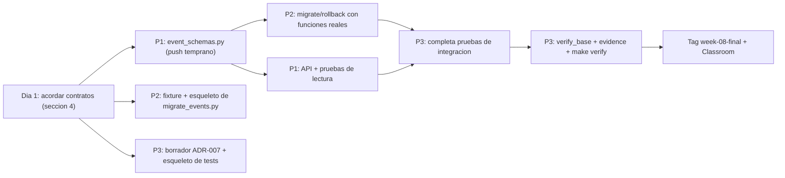

# 📦 M07 — Evolución compatible de documentos · Guía del equipo

**Equipo 3:** Salomón Álvarez Gómez · Yokio Yosafat Vázquez Carrillo · Diego de Jesús Huerta Barroso
**Estado del documento:** guía de trabajo pendiente, corregida al preparar M07. Los ejemplos no son evidencia ejecutada.

**Repo:** https://github.com/Yokio-Vazquez/DBntNube · **Tag a entregar:** `week-08-final`

---

## 1. Situación actual del proyecto

### Estado del repo (hoy)
- Base local verificada: `5cdf860`. El estado remoto queda por verificar.
- Hay 41 funciones de prueba; su aprobación completa y los servicios quedan por verificar.
- Tags entregados: `week-01-final` … `week-06-final`.

### Qué ya tenemos de semanas anteriores
| Módulo | Qué existe | Archivos clave |
|---|---|---|
| M02–M03 | PostgreSQL con modelo relacional, roles RBAC (`cdrl_migrator`, `cdrl_writer`, `cdrl_reader`, `cdrl_operator`) | `alembic/`, `db/migrations/`, `scripts/apply_security.py` |
| M04–M05 | DynamoDB Local, tabla `cdrl_events` (PK `game_id` + SK `event_key`, GSI `event-type-occurred-at-index` sobre `event_type` + `occurred_at`), CRUD con validación | `src/nosql.py`, `src/schemas.py`, `scripts/init_dynamodb.py` |
| M06 | Versiones de documento v1/v2 en lectura, auditoría append-only, recuperación ante desastre | `src/event_schemas.py`, `src/audit.py`, `scripts/disaster_recovery.py` |

### Cómo funcionan hoy las versiones de documentos
- `src/schemas.py` → `EventDocument` **escribe** documentos nuevos con `schemaVersion = 2`.
- `src/event_schemas.py` → `normalize_event()` **lee**: sin `schemaVersion` = v1; `2` = v2; otra = error.
- `GET /events?game_id=1` devuelve v1 y v2. Una versión desconocida responde **HTTP 500**.
- Pruebas: `tests/test_m06_document_versions.py` (4 pruebas). **Conservar expectativas v1/v2; el caso de versión desconocida usa `99` para permitir v3.**

### Limpieza ya hecha antes de M07
- `tests/test_m07_audit.py` → renombrado a `tests/test_m06_audit.py` (era la prueba de auditoría de M06).
- Eliminado el resto de `starter/cdrl-base/` del repo.

### ⚠️ Lo que falta y es justo lo que pide M07
1. v1 y v2 son **iguales** salvo el número de versión: no hay un cambio real de estructura.
2. **No hay migración** de los documentos ya guardados.
3. **No hay rollback.**
4. **No hay ADR** de compatibilidad.

---

## 2. Qué pide M07

> **Objetivo:** implementar versionado y migración compatible de documentos sin romper consumidores existentes.

| Criterio | Traducción | Cómo lo demostramos |
|---|---|---|
| La versión anterior sigue siendo legible durante la transición | Con v1, v2 y v3 mezclados en la tabla, `GET /events` sigue funcionando igual para quien ya lo usaba | Pruebas de lectura con tabla mixta |
| La migración es repetible | Correrla 2 veces da el mismo resultado | 2ª ejecución → `migrated = 0` |
| Rollback o equivalente probado | Poder regresar al estado anterior | `migrate` → `rollback` → tabla igual a la original |
| ADR con compatibilidad y límites | Qué cambios se permiten, cuáles no, qué se pierde | `docs/ADR-007-evolucion-documentos.md` |

**Entregables:**
- Código, scripts y configuración (todo por variables de entorno, **sin credenciales**).
- Pruebas: **1 caso normal, 2 casos límite y 1 fallo declarado** (mínimo).
- ADR en `docs/`.
- Resultado machine-readable: `artifacts/m07-migration-results.json`.
- Evidencia: `evidence/m07-document-evolution.json`.
- Classroom: URL del repo, tag `week-08-final`, SHA exacto, salida de `make verify` y evidencia.

**Evaluación (8 pts):** 5.5 automática · 2.0 semiautomática · 0.5 revisión manual. Puede haber **defensa oral**: cada uno debe poder explicar su parte.

> [!CAUTION]
> No se aceptan entregas tarde: después del cierre vale **0**.

---

## 3. Decisión técnica (qué vamos a construir)

### Nueva versión v3 (solo agrega campos, nada se renombra ni se borra)
| Campo | v1 | v2 | **v3** |
|---|---|---|---|
| `game_id`, `event_key`, `event_type`, `occurred_at`, `source` | ✅ | ✅ | ✅ **sin cambios** (son llaves e índice: **prohibido renombrarlos**) |
| `schemaVersion` | no existe (=1) | `2` | `3` |
| `platform` | — | — | **nuevo**: `"pc" \| "console" \| "mobile" \| "unknown"` |
| `metadata` | — | — | **nuevo**: mapa opcional, default `{}` |
| `migratedFrom` | — | — | marca interna: `1` o `2` si el doc vino de migración; **no existe** si se escribió directo en v3 |

### Cómo se hace la transición (patrón *expand → migrate → contract*)
1. **Expand:** el lector acepta v1, v2 y v3. A lo viejo le pone defaults (`platform="unknown"`, `metadata={}`) cuando se pide v3.
2. **Escritura controlada por variable:** `EVENT_WRITE_VERSION` (default `2`). Si vale `3`, los nuevos se escriben en v3. Regresarla a `2` es el rollback de los escritores.
3. **Migrate:** un script convierte v1/v2 → v3 y es seguro correrlo varias veces.
4. **Rollback:** regresa **solo** los docs que tienen `migratedFrom` a su versión original.
5. **Contract** (borrar soporte v1/v2): **fuera de alcance**, se declara en el ADR.

### Compatibilidad del API
- `GET /events?game_id=1` → **igual que hoy** (los clientes viejos no notan nada; v3 solo agrega campos).
- `GET /events?game_id=1&version=3` → todo convertido a v3.
- `GET /events?game_id=1&version=2` → todo proyectado a v2 (sin campos nuevos).
- `GET /events?game_id=1&version=9` → **422**.

### ⚠️ Regla de la tabla de pruebas
`make verify` corre `disaster_recovery.py`, que **borra toda `cdrl_events`** y la vuelve a llenar. Las pruebas de M07 **no deben usar esa tabla**:
- Usan `cdrl_events_m07_test`, configurable con la variable `DYNAMODB_TABLE_M07_TEST`.
- Cada prueba crea una tabla exclusiva y la borra al final; agregar sufijo único si hay ejecución paralela.

---

## 4. Contratos compartidos (acordarlos el día 1)

> [!IMPORTANT]
> Así los 3 trabajan en paralelo. **Persona 1** implementa las funciones de esquema y **Persona 2** las del script. **Persona 3** las usa en las pruebas. Si alguien necesita cambiar una firma, avisa en el grupo **antes** de hacer push.

```python
# src/event_schemas.py  (Persona 1)
SUPPORTED_VERSIONS = {1, 2, 3}

class EventV3(EventDocumentBase):
    schema_version: Literal[3] = Field(default=3, alias="schemaVersion")
    platform: Literal["pc", "console", "mobile", "unknown"] = "unknown"
    metadata: dict = Field(default_factory=dict)
    migrated_from: int | None = Field(default=None, alias="migratedFrom")

def detect_version(doc: Mapping) -> int
    # 1 si no hay schemaVersion; si la versión no está en SUPPORTED_VERSIONS -> UnsupportedEventVersion

def upcast_to_v3(doc: Mapping) -> dict
    # v1/v2 -> dict v3 con platform="unknown", metadata={}, migratedFrom=<versión original>
    # v3 -> se devuelve igual (idempotente)

def downcast_from_v3(doc: Mapping) -> dict
    # v3 con migratedFrom -> dict en su versión original (v1 sin schemaVersion, v2 con schemaVersion=2)
    # quita platform, metadata, migratedFrom
    # v3 sin migratedFrom -> ValueError (no se puede bajar un doc nativo v3)

def project(doc: Mapping, target: int) -> dict
    # para GET /events?version=  (target 1, 2 o 3)
```

```python
# scripts/migrate_events.py  (Persona 2)
def migrate_table(table, dry_run: bool = False) -> dict
    # -> {"operation":"migrate","scanned":int,"migrated":int,"skipped":int,
    #     "failed":[{"game_id":..,"event_key":..,"reason":..}],"durationSeconds":float}

def rollback_table(table, dry_run: bool = False) -> dict
    # -> {"operation":"rollback","scanned":int,"rolledBack":int,"skipped":int,"failed":[...],"durationSeconds":float}
```

```text
# Variables de entorno nuevas (.env.example)
EVENT_WRITE_VERSION=2                      # cambiar a 3 al terminar la migración
DYNAMODB_TABLE_M07_TEST=cdrl_events_m07_test
```

---

## 5. Actividades por persona

### 👤 Persona 1 — Modelo v3 y lectura compatible (API)
**Responsabilidad:** que v1, v2 y v3 se lean al mismo tiempo sin romper a los consumidores actuales.

**Tareas**
1. `src/event_schemas.py`
   - Agregar `EventV3`, `SUPPORTED_VERSIONS`, `detect_version`, `upcast_to_v3`, `downcast_from_v3`, `project` (firmas de la sección 4).
   - Actualizar `normalize_event()` para aceptar v3.
2. `src/schemas.py`
   - `EventDocument` lee `EVENT_WRITE_VERSION` (`2` por defecto).
   - Si es `3`, exige `platform` válido y acepta `metadata` opcional. Con `2`, se comporta exactamente como hoy.
   - Cualquier otro valor de la variable → error claro al arrancar.
3. `src/main.py` — `GET /events`
   - Nuevo query param opcional `version: int | None = Query(default=None, ge=1, le=3)`.
   - Sin `version` → comportamiento actual (no cambiar respuesta para v1/v2).
   - Con `version` → aplicar `project(doc, version)`.
   - Fuera de rango → 422 (FastAPI lo da solo con `ge`/`le`).
   - Doc con versión desconocida en la tabla → **500** (se mantiene igual).
4. `.env.example` → agregar `EVENT_WRITE_VERSION=2` con un comentario.
5. `tests/test_m07_compat_read.py` (unitarias con `monkeypatch`, **no necesitan Docker**):
   - Tabla mixta v1 + v2 + v3 sin `version` → 200 y los v1/v2 salen igual que antes.
   - `?version=3` → todos traen `platform` y `metadata`.
   - `?version=2` sobre doc v3 → sin `platform`/`metadata`/`migratedFrom`.
   - `?version=9` → 422.
   - `upcast_to_v3(upcast_to_v3(d)) == upcast_to_v3(d)`.
   - `downcast_from_v3(upcast_to_v3(d_v1)) == d_v1` (ida y vuelta).
   - `downcast_from_v3(doc_v3_nativo)` → `ValueError`.

**Criterios de terminado**
- [ ] Las 4 pruebas de `test_m06_document_versions.py` pasan con el caso de versión desconocida preparado con `99`, conservando las expectativas v1/v2.
- [ ] `python -m pytest tests/test_m07_compat_read.py` en verde.
- [ ] Push temprano de `event_schemas.py`, porque Persona 2 y 3 dependen de él.

**Commits sugeridos**
- `feat(m07): EventV3 y funciones upcast/downcast/project (Persona 1)`
- `feat(m07): GET /events con parametro version y flag EVENT_WRITE_VERSION (Persona 1)`
- `test(m07): pruebas de lectura compatible v1/v2/v3 (Persona 1)`

**Para la defensa oral:** ¿por qué v3 es compatible hacia atrás? (Solo agrega campos; los clientes viejos los ignoran.) ¿Por qué no se pueden renombrar `occurred_at` ni `event_type`? (Son llave del GSI.)

---

### 👤 Persona 2 — Migración repetible y rollback (datos)
**Responsabilidad:** convertir los documentos guardados de v1/v2 a v3 de forma segura y repetible, y poder revertir.

**Tareas**
1. `scripts/migrate_events.py`
   - CLI: `python scripts/migrate_events.py [--rollback] [--dry-run] [--table NOMBRE] [--report RUTA]`
     - `--table` por defecto = `DYNAMODB_TABLE` (variable de entorno).
     - `--report` por defecto = `artifacts/m07-migration-results.json`.
   - Implementar `migrate_table(table, dry_run)` y `rollback_table(table, dry_run)` (firmas de la sección 4).
   - `scan` **paginado** (usar `LastEvaluatedKey`, igual que en `disaster_recovery.py`).
   - **Migrate**:
     - v1/v2 → `upcast_to_v3(doc)`, guardado con `put_item` condicionado a que el documento exista y conserve su versión de origen (atributo ausente para v1 implícita, `1` para v1 explícita, `2` para v2).
     - Si la condición falla (otro proceso ya lo migró) → cuenta como `skipped`, **no** como error.
     - Docs que ya están en v3 → `skipped`.
   - **Rollback**:
     - Solo docs con `migratedFrom` → `downcast_from_v3(doc)`, con condición que exija documento existente, `schemaVersion == 3` y `migratedFrom` igual al valor leído.
     - v3 nativo (sin `migratedFrom`) → `skipped`. v1/v2 → `skipped`.
   - **Docs inválidos** (versión desconocida como `99`, o sin campos obligatorios):
     - Van a `failed` con su motivo y **no se modifican**.
     - El script termina con **exit code 2** si hubo `failed`, `0` si todo salió bien.
   - `--dry-run` → cuenta todo pero **no escribe nada**.
   - El reporte JSON **acumula corridas** en `runs`. Las funciones devuelven `failed` como lista; el resumen guarda su cantidad y conserva detalles en `failureDetails`. Calcular `idempotent` y `rollbackVerified` mediante snapshots, nunca solo contadores. Ejemplo esperado, no evidencia ejecutada:
     ```json
     {
       "assignmentId": "m07-document-evolution",
       "table": "cdrl_events_m07_test",
       "fixture": "tests/fixtures/m07_mixed_versions.json",
       "runs": [
         {"operation": "migrate",  "scanned": 6, "migrated": 4, "skipped": 1, "failed": 1, "durationSeconds": 0.05},
         {"operation": "migrate",  "scanned": 6, "migrated": 0, "skipped": 5, "failed": 1, "durationSeconds": 0.03},
         {"operation": "rollback", "scanned": 6, "rolledBack": 4, "skipped": 1, "failed": 1, "durationSeconds": 0.04}
       ],
       "idempotent": true,
       "rollbackVerified": true
     }
     ```
2. `tests/fixtures/m07_mixed_versions.json` (todo sintético, `source: "synthetic-fixture"`):
   - 2 docs **v1** (sin `schemaVersion`).
   - 2 docs **v2** (`schemaVersion: 2`).
   - 1 doc **v3 nativo** (`schemaVersion: 3`, `platform: "pc"`, sin `migratedFrom`).
   - Los v3 previamente migrados se prueban aparte: agregar uno con `migratedFrom: 2` y comprobar que el rollback global lo devuelve a v2. No incluirlo en el fixture principal de igualdad exacta.
   - 1 doc **inválido** (`schemaVersion: 99`).
3. `Makefile` → agregar targets nuevos (no tocar `setup`/`verify`/`run`, eso lo coordina Persona 3):
   ```make
   migrate:
	@$(PYTHON) scripts/migrate_events.py
   rollback:
	@$(PYTHON) scripts/migrate_events.py --rollback
   ```
   Agregarlos también a `.PHONY`.

**Criterios de terminado**
- [ ] 2 corridas seguidas de `migrate` → la segunda reporta `migrated: 0`.
- [ ] `migrate` → `rollback` → los docs quedan **iguales** a como estaban antes (el inválido nunca se toca).
- [ ] `rollback` **no** baja el v3 nativo.
- [ ] `--dry-run` no cambia la tabla.
- [ ] Nada de credenciales; todo se lee de `.env`.

**Commits sugeridos**
- `feat(m07): script de migracion idempotente v1/v2 a v3 (Persona 2)`
- `feat(m07): rollback selectivo por migratedFrom y dry-run (Persona 2)`
- `test(m07): fixture sintetico de versiones mixtas (Persona 2)`

**Para la defensa oral:** ¿qué hace repetible la migración? (`ConditionExpression` + skip de v3, con escritores detenidos.) ¿Qué se pierde en el rollback? (`platform` y `metadata` de los docs migrados.) ¿Por qué no se bajan los v3 nativos? (No tienen versión original a la cual volver.)

---

### 👤 Persona 3 — Pruebas de integración, ADR, evidencia y entrega
**Responsabilidad:** demostrar con pruebas los 4 criterios, documentar compatibilidad y límites, y dejar todo verde para entregar.

**Tareas**
1. `tests/test_m07_document_evolution.py` (contra DynamoDB Local, **tabla aislada**):
   - Fixture de pytest que:
     - crea `cdrl_events_m07_test` con la misma llave y GSI que `cdrl_events` (reusar `TABLE_KEY_SCHEMA`, `ATTRIBUTE_DEFINITIONS`, `EVENT_TYPE_INDEX_DEFINITION` de `src/nosql.py`);
     - carga `tests/fixtures/m07_mixed_versions.json`;
     - **borra la tabla al final**.

   | Tipo | Prueba | Criterio |
   |---|---|---|
   | **Normal** | `migrate` sobre el fixture → todos los válidos quedan `schemaVersion: 3`, y leerlos con `normalize_event` funciona | Legible + migración |
   | **Límite 1** | `migrate` dos veces → 2ª vez `migrated == 0` y los docs son idénticos a la 1ª | Repetible |
   | **Límite 2** | Tabla vacía → `migrate` y `rollback` regresan todo en 0 sin error | Bordes |
   | **Rollback** | Snapshot inicial → `migrate` → `rollback` → snapshot igual al inicial; el v3 nativo sigue en v3 | Rollback probado |
   | **Fallo declarado** | Doc `schemaVersion: 99` → aparece en `failed`, no cambia, y el CLI sale con código **2** | Fallo controlado |
   | **Compat API** | Con la tabla ya migrada, `GET /events` sin `version` responde 200 | No rompe consumidores |

2. `docs/ADR-007-evolucion-documentos.md`
   - **Estado / Contexto** (v1 y v2 ya conviven desde M06).
   - **Decisión:** v3 aditivo, *expand → migrate → contract*, flag `EVENT_WRITE_VERSION`, marca `migratedFrom`, `GET /events?version=`.
   - **Reglas de compatibilidad:**
     - ✅ Permitido: agregar campos opcionales con default.
     - ❌ Prohibido: renombrar o borrar `game_id`, `event_key`, `event_type`, `occurred_at` (llave/GSI), cambiar tipos, volver obligatorio un campo viejo.
   - **Límites:**
     - El rollback pierde `platform`/`metadata` de los docs migrados.
     - Los v3 nativos no se pueden bajar.
     - DynamoDB no tiene transacciones sobre toda la tabla: la migración es por documento y repetible, no atómica.
     - La fase *contract* queda fuera de alcance.
     - Ventana de transición: mientras exista algún doc v1/v2, el lector debe soportarlos.
   - **Consecuencias** y **cómo ejecutar** (`make migrate`, `make rollback`).
3. `evidence/m07-document-evolution.json` con los campos:
   - `assignmentId: "m07-document-evolution"`, `commitSha` (**SHA del commit de código evaluado, anterior al commit de evidencia**).
   - `team`: las 3 personas, con su rol, sus `commitShas` y sus archivos.
   - `compatibilityTests`, `migrationTests`, `rollbackTests`, `failureTests`.
   - `commands`, `results`, `assumptions`, `limitations`.
4. `scripts/verify_base.py`
   - Agregar a `REQUIRED_FILES`: ADR-007, evidence M07, `artifacts/m07-migration-results.json`, `scripts/migrate_events.py`, `tests/fixtures/m07_mixed_versions.json`.
   - Validar los campos de la evidencia M07 y que el artifact tenga `idempotent == true` y `rollbackVerified == true`.
5. `Makefile` → en `verify`, antes de pytest, correr la demo de migración sobre la tabla de prueba para regenerar el artifact, por ejemplo con un `scripts/m07_demo.py` que haga crear tabla → cargar fixture → migrate ×2 → rollback → borrar tabla.
6. **Entrega:** commit de evidencia → tag `week-08-final` → push → txt de Classroom con la salida de `make setup && make verify && make run`.

**Criterios de terminado**
- [ ] `make setup && make verify && make run` en verde, en limpio.
- [ ] GitHub Actions ✅ en el tag.
- [ ] `commitSha` identifica el código probado; el SHA del tag final se entrega externamente. No exigir que un archivo contenga el SHA del mismo commit que lo incorpora.

**Commits sugeridos**
- `test(m07): pruebas de evolucion, idempotencia, rollback y fallo declarado (Persona 3)`
- `docs(m07): ADR-007 compatibilidad y limites (Persona 3)`
- `chore(m07): verify, evidencia y artifact M07 (Persona 3)`

**Para la defensa oral:** ¿cómo prueban que la migración es repetible? ¿Por qué usan una tabla aparte para las pruebas? ¿Qué cubre cada caso (normal, límite, fallo)?

---

## 6. Orden de trabajo



---

## 7. Reglas de git (autoría individual)

```bash
git pull origin main                 # SIEMPRE antes de empezar
# ... trabajar ...
python -m pytest                     # que todo pase antes de subir
git add <solo tus archivos>
git commit -m "feat(m07): ... (Persona X)"
git pull --rebase origin main        # traer lo de los demás
git push origin main
```

- Cada quien hace commits **con su propia cuenta de GitHub**: se evalúa la autoría técnica individual.
- Archivos compartidos (`Makefile`, `.env.example`, `verify_base.py`): cambios pequeños, avisar en el grupo, pull antes de push.
- **Nunca** subir `.env`, tokens ni contraseñas. Solo `.env.example` con valores de ejemplo.
- Solo **Persona 3** crea el tag `week-08-final`, cuando todo esté integrado.

---

## 8. Preparar el entorno (problemas comunes)

```bash
git pull origin main
make setup && make verify && make run
```

| Problema | Solución |
|---|---|
| `port is already allocated` (5432 u 8000) | Hay contenedores viejos: `docker ps -a`, luego `docker stop cdrl-base-postgres-1 cdrl-base-dynamodb-1` |
| `ResourceNotFoundException ... non-existent table` | DynamoDB Local es en memoria: correr `make setup` después de cada reinicio de Docker |
| `make setup` se queda colgado en DynamoDB | El contenedor quedó sin puerto: `docker compose up -d --force-recreate dynamodb` |
| "El sistema no puede encontrar la ruta especificada" en Windows | Es inofensivo (detección de `python3` en el Makefile); no aparece en Linux/CI |

---

## 9. Checklist final de entrega

- [x] `src/event_schemas.py`, `src/schemas.py`, `src/main.py` con v3 (P1)
- [x] `tests/test_m07_compat_read.py` (P1)
- [ ] `scripts/migrate_events.py` + `tests/fixtures/m07_mixed_versions.json` + targets `migrate`/`rollback` (P2)
- [ ] `tests/test_m07_document_evolution.py` con normal, 2 límites, rollback y fallo declarado (P3)
- [ ] `docs/ADR-007-evolucion-documentos.md` (P3)
- [ ] `artifacts/m07-migration-results.json` con `idempotent: true` y `rollbackVerified: true`
- [ ] `evidence/m07-document-evolution.json` con el SHA del código evaluado
- [ ] `verify_base.py` valida M07
- [ ] `make setup && make verify && make run` ✅ y GitHub Actions ✅
- [ ] Tag `week-08-final` en GitHub
- [ ] Classroom: URL del repo, tag, SHA exacto, salida de `make verify` y evidencia


## 10. Precisiones de los contratos antes de implementar

### Rollback y conservación

El rollback es global: revierte todos los documentos con `migratedFrom`, incluso migraciones anteriores. No revierte solamente el último lote. La igualdad con el snapshot inicial se exige en el fixture principal de seis documentos, sin v3 previamente migrados. La prueba separada verifica que un v3 previamente migrado vuelve a v2.

`migratedFrom` solo admite `1` o `2`; los escritores no pueden suministrarlo. Para una ida y vuelta exacta, conservar la diferencia entre v1 implícita y v1 explícita con `schemaVersion: 1`: registrar la presencia original en una marca interna adicional y retirarla al revertir. No descartar atributos originales adicionales. Rechazar sin modificar v1/v2 con campos reservados de v3 o de migración ya presentes. Probar ambas formas de v1 y documentos con atributos adicionales.

La proyección HTTP no es un rollback persistente: puede proyectar v3 nativo a v2 sin alterar almacenamiento. Las proyecciones v1/v2 omiten campos de v3 y marcas internas; v1 HTTP conserva `schemaVersion: 1` como en M06.

### Concurrencia y demostración

Alcance inicial: detener todos los escritores y otros migradores durante migrate/rollback. Las condiciones comprueban existencia y versión, pero no impiden sobrescribir cambios concurrentes en otros campos. No afirmar seguridad con escritores activos; eso requeriría control de revisión o comparación del documento leído. Documentar esta limitación. Una condición fallida se contabiliza como conflicto omitido; no demuestra por sí sola que otro proceso haya migrado el documento.

`--dry-run` valida y cuenta operaciones previstas sin modificar datos; identificarlo en el reporte. Una simulación no demuestra idempotencia o rollback. Comparar snapshots paginados por clave, independientes del orden de documentos/mapas, con números DynamoDB serializados consistentemente.

### Verificación y entrega

Al integrar M07, generar los resultados de ejecución M06/M07 antes de validar artifacts obligatorios y luego ejecutar pytest. La demo M07 usa una tabla exclusiva y limpieza en `finally`. No ejecutar recuperación destructiva contra datos compartidos.

Secuencia: commit de código -> ejecutar verificación y registrar ese SHA -> commit de evidencia -> tag final. Cualquier cambio funcional posterior exige repetir la verificación. El SHA del tag final se comunica en Classroom o en un manifiesto externo al commit etiquetado. No inventar resultados, autorías ni contribuciones.

La compatibilidad aditiva presupone clientes que toleran campos nuevos. Clientes estrictos deben solicitar `version=2`. En escritura v3, exigir `platform` válido; el default `unknown` sirve para lectura/upcast de documentos antiguos. Validar `EVENT_WRITE_VERSION` al inicio y probar ambos modos.

`.gitignore` permite versionar `artifacts/m07-migration-results.json`; crearlo solo tras una ejecución real. Persona 1 está implementada y documentada en `docs/M07-persona1-implementacion.md`; la migración e integración de Personas 2 y 3 siguen pendientes.
